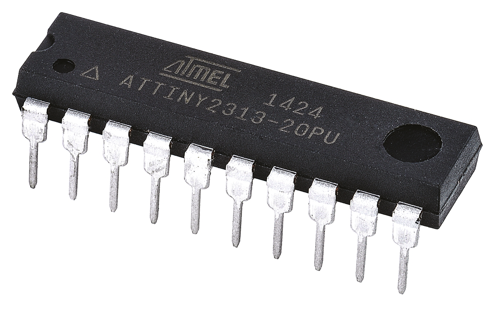
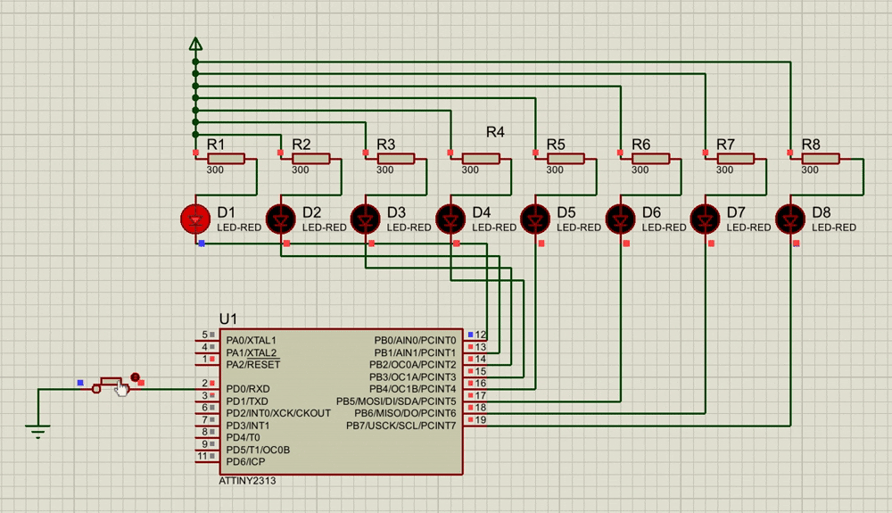

# LED garland programming on AVR microcontoller
The goal of this project was to study the AVR microcontollers. The following is a [CodeVisionAVR](https://www.codevision.be/) project that can be used to build a new firmware for the microcontroller. As a SPICE system to simulate the circute you can use the [Proteus](https://www.labcenter.com/) project that is already configured.

## Components
The circute consists of 8 red LED (2.2V, 10mA), 8 resistors (300 OHM), power source (5V), button, ground and a ATtiny2313 microcontroller.

## Demo
The program should simulate a loop of running lights, pushing the button makes it change the direction.

## Resources
- [ATtiny2313](ATTINY2313.pdf)